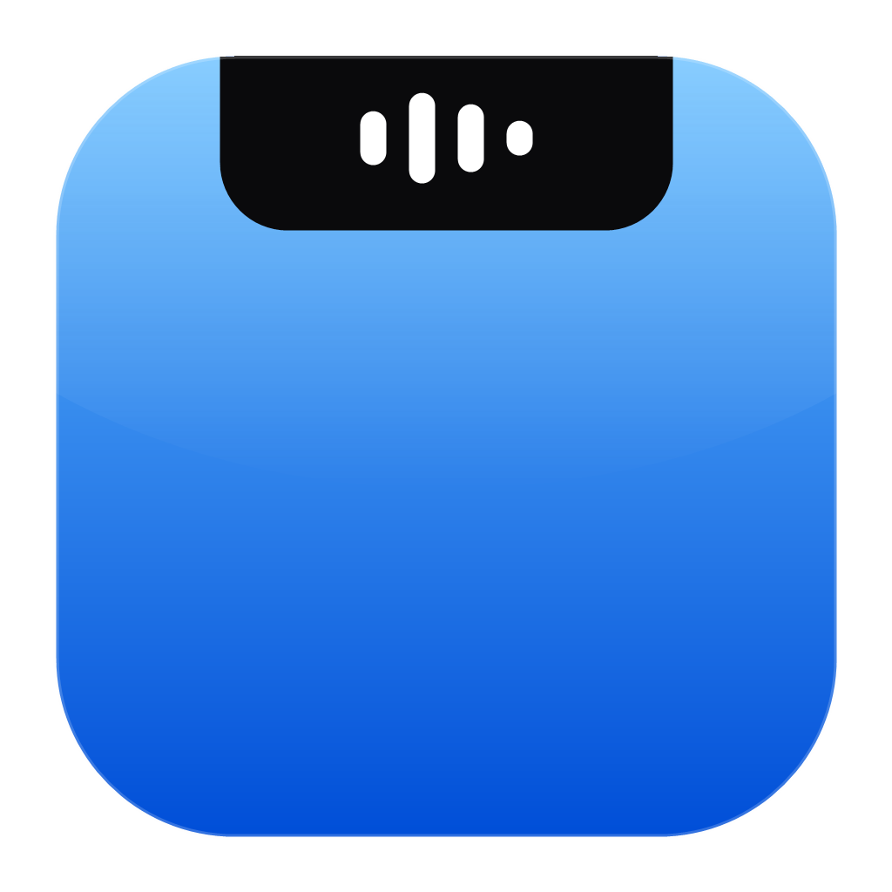

<p align="center">
  
</p>

<h1 align="center">Ponian</h1>

<p align="center">
  A Dynamic Island–style notch for Windows.<br>
  Music and synced lyrics, a timer, to-dos, a calendar, prayer times, a file shelf, and system pop-ups in one small pill at the top of your screen.
</p>

---

Ponian sits at the top centre of your display as a small pill showing the clock and battery. Move the pointer onto it and it opens into a panel of pages you can scroll through. When something happens (volume changes, a notification arrives, a reminder is due) the pill grows just enough to show it, then shrinks back.

It is a single native executable of about 650 KB, written in Rust and drawn with Direct2D. It typically uses 15–25 MB of private memory and no CPU while idle.

## Features

**The pill**

- Clock, battery ring, and an audio indicator while media is playing
- Synced lyrics for the current song, one line at a time; the pill resizes to fit each line
- Pop-ups for volume, brightness, Caps Lock, input language, low or full battery, Wi-Fi, and audio device changes
- App notifications mirrored from Windows; click one to open the app that sent it
- Shrinks to a thin line while a maximized window is in front, so it does not cover tabs or title bars
- Hides completely while a full-screen app is running

**Pages** (scroll, click the edge buttons, or use the dots at the bottom)

| Page | What it does |
|---|---|
| Music | Cover art, seek bar, playback controls, lyrics toggle, and a source switcher when more than one player is active |
| Apps | Up to 23 shortcuts; add with `+` or by dropping an `.exe` or shortcut, right-click to rename, move, or remove |
| Timer | Presets, custom durations, and a stopwatch |
| Shelf | Drop files to keep them handy and drag them back out; clipboard history for text, images, and files |
| To-do | Tasks with optional time and date (`Team meeting tomorrow 14:30`), with reminders and snooze |
| Calendar | Month view, Indonesian public holidays, events from an iCal link, and your scheduled tasks |
| Today | Tasks, the next public holiday, weather, the next prayer time, and the latest notification |
| Widgets | Two of: world clock, countdown, moon phase, next prayer, date (with Hijri date), weather, exchange rates |
| Prayer | The five daily prayer times for your location, with reminders |

**Other**

- Copy text from anywhere on screen with `Ctrl+Alt+T` (uses the OCR engine built into Windows, offline)
- A macOS-style settings window: reorder or hide pages, choose the display and size, pick widgets, mute notifications per app
- Optional launch at Windows startup

## Install

1. Download `ponian.exe` from the [latest release](../../releases/latest).
2. Run it. There is no installer; Ponian appears at the top of the screen and adds an icon to the system tray.
3. Right-click the tray icon for **Settings** or **Quit Ponian**.

The executable is not code-signed, so Windows SmartScreen may warn the first time you run it.

**Requirements:** Windows 10 version 1903 or later, 64-bit. Windows 11 is recommended: the translucent settings window needs it, and Windows 10 falls back to a plain dark window.

## Privacy

Ponian has no account, no telemetry, and no server of its own. These are the only requests it makes, and each can be turned off in Settings:

| Feature | Service | What is sent |
|---|---|---|
| Lyrics | [LRCLIB](https://lrclib.net) | Song title, artist, and duration |
| Weather | [MET Norway](https://api.met.no) | Your coordinates, rounded |
| Exchange rates | [Frankfurter](https://frankfurter.dev) | Nothing personal |
| Public holidays | Google's public holiday calendar | Nothing personal |
| Calendar events | The iCal link you provide | Nothing beyond the request itself |

Everything else stays on your computer. Settings are stored under `HKCU\Software\Ponian` in the registry (the iCal link is encrypted with Windows DPAPI), and tasks, shortcuts, and the shelf are plain text files in `%APPDATA%\Ponian`. Clipboard history is kept in memory only unless you choose to keep it between sessions, and content that password managers mark as private is never recorded.

## Build from source

You need the Rust toolchain with the MSVC target (`x86_64-pc-windows-msvc`) and the Windows SDK.

```powershell
cargo build --release
```

The executable is written to `target\release\ponian.exe`. Run the unit tests with `cargo test --release`.

The app icon is generated by `assets\make-icon.ps1`, which also rebuilds `assets\ponian.res`, the precompiled resource that `build.rs` links into the executable.

## Known limitations

- The settings window is custom-drawn and is not readable by screen readers.
- Holiday data covers Indonesia only.
- Prayer reminders are not shown while a full-screen app has the notch hidden.
- Lyrics appear only for players that report playback position to Windows (Spotify and most browsers do).

## Credits

Made by **kucingbebal**.

Lyrics from LRCLIB. Weather data from MET Norway, licensed under CC BY 4.0. Exchange rates from Frankfurter, which publishes European Central Bank reference rates. Holidays from Google's public holiday calendar.
